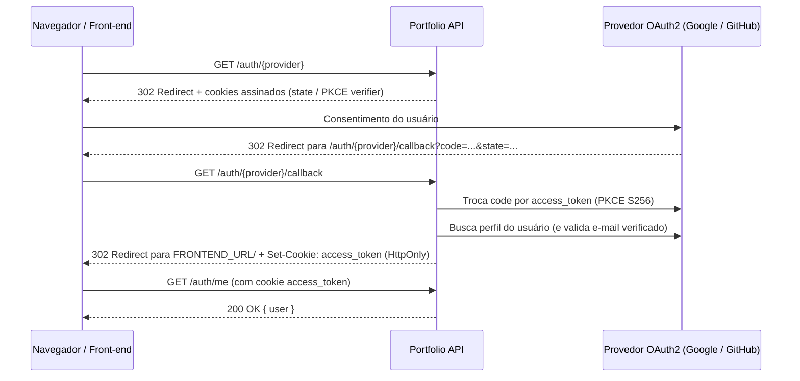

# Portfolio — API

Backend do projeto **Portfolio**, construído em um monorepo gerenciado por **npm workspaces** com arquitetura **100% stateless (sem banco de dados)**.

A API fornece autenticação OAuth2 (Google e GitHub) com sessão stateless em cookie `HttpOnly` JWT, entrega controlada de currículo em PDF (variante censurada por padrão e variante completa desbloqueada por código diário determinístico) e documentação interativa OpenAPI via Swagger UI.

> **Nota:** Esta documentação está focada na **API (`apps/api`)**, que já se encontra finalizada. Informações detalhadas do front-end (`apps/web`) serão adicionadas conforme o desenvolvimento avançar.

---

## Sumário

- [Visão Geral da Arquitetura](#visão-geral-da-arquitetura)
- [Stack Tecnológica](#stack-tecnológica)
- [Estrutura do Projeto](#estrutura-do-projeto)
- [Módulos e Fluxos do Sistema](#módulos-e-fluxos-do-sistema)
  - [Autenticação Stateless (OAuth2 + JWT)](#autenticação-stateless-oauth2--jwt)
  - [Entrega Controlada de Currículo (Resume)](#entrega-controlada-de-currículo-resume)
- [Segurança](#segurança)
- [Documentação OpenAPI (Swagger)](#documentação-openapi-swagger)
- [Referência de Endpoints](#referência-de-endpoints)
- [Variáveis de Ambiente](#variáveis-de-ambiente)
- [Como Executar](#como-executar)
- [Extensibilidade: Adicionando Novos Provedores OAuth2](#extensibilidade-adicionando-novos-provedores-oauth2)
- [Notas para Integração com o Front-end](#notas-para-integração-com-o-front-end)

---

## Visão Geral da Arquitetura

O repositório é organizado como um monorepo com três áreas principais:

- **`apps/api`**: API HTTP em Node.js (ESM) com Fastify v5, TypeScript estrito e Zod v4.
- **`shared`**: Schemas Zod, tipos inferidos e validação centralizada de variáveis de ambiente compartilháveis entre workspaces.
- **`apps/web`**: Front-end (em desenvolvimento).

### Princípios Arquiteturais da API

- **100% Stateless**: Não utiliza banco de dados nem armazenamento de sessão em servidor. Tanto a autenticação (JWT em cookie `HttpOnly`) quanto o código diário do currículo (`HMAC-SHA256` determinístico) funcionam sem persistência.
- **Factory isolada (`buildServer`)**: A criação da instância Fastify é isolada em `apps/api/src/server.ts`, e `server.listen()` só é executado quando o arquivo é o entrypoint principal. Isso permite testar a aplicação diretamente em memória via `server.inject()`.
- **Ordem explícita de registro de plugins**:
  1. `@fastify/cors`
  2. `@fastify/cookie`
  3. `@fastify/rate-limit`
  4. `@fastify/jwt`
  5. `@fastify/swagger` e `@fastify/swagger-ui`
  6. Decoração de serviços (`authService`, `tokenService`, `resumeService`)
  7. Registro de rotas (`/auth`, `/resume`)
- **Contratos fortemente tipados com Zod**: Validação de entrada, serialização de saída, tipos TypeScript e documentação OpenAPI derivam dos mesmos schemas Zod via `@fastify/type-provider-zod`.

---

## Stack Tecnológica

| Categoria | Tecnologia |
| :--- | :--- |
| **Runtime** | Node.js 24+ (ESM) |
| **Linguagem** | TypeScript (modo `strict`) |
| **Framework HTTP** | Fastify v5 |
| **Validação e OpenAPI** | Zod v4 + `@fastify/type-provider-zod` |
| **Documentação** | `@fastify/swagger` + `@fastify/swagger-ui` (OpenAPI 3.0.3) |
| **Autenticação** | `@fastify/oauth2`, `@fastify/jwt`, `@fastify/cookie` |
| **Proteção HTTP** | `@fastify/cors`, `@fastify/rate-limit` |
| **Dev & Build** | `tsx` (`--env-file=../../.env`), `tsc` + `tsc-alias` |
| **Containerização** | Docker & Docker Compose |

---

## Estrutura do Projeto

```text
portfolio/
├── apps/
│   ├── api/
│   │   ├── assets/
│   │   │   └── curriculo-dev-censurado.pdf     # Variante pública/censurada do currículo
│   │   ├── private/
│   │   │   └── curriculo-dev.pdf               # Variante completa (ignorada no Git)
│   │   ├── src/
│   │   │   ├── server.ts                       # Factory buildServer() e bootstrap
│   │   │   ├── config/
│   │   │   │   └── swagger.ts                  # Configuração OpenAPI e Swagger UI (/docs)
│   │   │   ├── types/
│   │   │   │   └── fastify.d.ts                # FastifyTypedInstance, FastifyJWT e decorators
│   │   │   └── modules/
│   │   │       ├── auth/
│   │   │       │   ├── auth.routes.ts          # Registro dinâmico de OAuth2, /me e /logout
│   │   │       │   ├── auth.schema.ts          # Schemas Zod de callback, /me e erros
│   │   │       │   ├── auth.service.ts         # Orquestração de provedores e redirects
│   │   │       │   ├── token.service.ts        # Emissão de JWT e política do cookie de sessão
│   │   │       │   ├── middlewares/
│   │   │       │   │   └── auth.middleware.ts  # preHandler authenticate (cookie JWT)
│   │   │       │   └── providers/
│   │   │       │       ├── oauth-provider.ts   # Contrato OAuthProvider, helpers e AuthError
│   │   │       │       ├── google.provider.ts  # Adaptador Google OAuth2 (PKCE S256)
│   │   │       │       ├── github.provider.ts  # Adaptador GitHub OAuth2 (PKCE S256)
│   │   │       │       └── index.ts            # Lista central de provedores registrados
│   │   │       └── resume/
│   │   │           ├── resume.routes.ts        # Rotas GET /resume/ e GET /resume/code
│   │   │           ├── resume.schema.ts        # Schemas Zod de headers, PDF, código e erros
│   │   │           └── resume.service.ts       # Código diário HMAC-SHA256 e resolução de PDF
│   │   ├── Dockerfile
│   │   ├── package.json
│   │   └── tsconfig.json
│   └── web/                                    # Front-end (em desenvolvimento)
├── shared/
│   ├── config/
│   │   └── env.ts                              # Schema Zod e parse centralizado de variáveis
│   └── schemas/
│       └── jwt.schema.ts                       # authProviderSchema e userPayloadSchema
├── .env.example                                # Modelo de variáveis de ambiente
├── docker-compose.yml                          # Orquestração local de containers
└── package.json                                # Workspaces e dependências compartilhadas
```

### Path Aliases configurados em `apps/api`

- `@/*` → `apps/api/src/*`
- `@shared/*` → `shared/*`

---

## Módulos e Fluxos do Sistema

### Autenticação Stateless (OAuth2 + JWT)

A sessão do usuário é mantida exclusivamente através de um JWT assinado armazenado no cookie `HttpOnly` chamado `access_token`. Não há refresh tokens nem persistência de sessão em banco; o tempo de vida do token e o `maxAge` do cookie são sincronizados automaticamente a partir de `JWT_EXPIRES_IN`.



#### Detalhes dos Provedores Configurados

- **Google (`google`)**:
  - Escopos: `openid`, `email`, `profile` com PKCE `S256`.
  - Consulta `https://www.googleapis.com/oauth2/v3/userinfo` (timeout de 10s).
  - Exige `email_verified: true`; caso contrário, falha com código `email_not_verified`.
- **GitHub (`github`)**:
  - Escopos: `read:user`, `user:email` com PKCE `S256`.
  - Consulta em paralelo `https://api.github.com/user` e `https://api.github.com/user/emails` (timeout de 10s).
  - Seleciona o e-mail primário verificado (ou, como fallback, o primeiro e-mail verificado); caso não haja nenhum, falha com código `email_not_verified`.

#### Tratamento de Erros no Callback OAuth2

Em qualquer falha durante o callback (`GET /auth/{provider}/callback`), a API registra os detalhes apenas nos logs internos do servidor (`request.log.error`) e redireciona o navegador para `${FRONTEND_URL}/login?error=<codigo>`, sem expor tokens ou stack traces na URL. Exemplos de códigos retornados:

- `access_denied`: usuário cancelou ou negou o consentimento no provedor.
- `invalid_callback`: ausência de `code` ou `state` na query string.
- `email_not_verified`: conta sem e-mail verificado.
- `auth_failed`: erro genérico na troca de token ou comunicação externa.

---

### Entrega Controlada de Currículo (Resume)

O módulo `resume` protege o download do currículo em PDF exigindo autenticação prévia via cookie `access_token` e oferece dois níveis de acesso:

1. **Variante Censurada (`censored`)**:
   - Retornada por padrão em `GET /resume/` quando o header `x-resume-code` não é enviado.
   - Lê o arquivo `apps/api/assets/curriculo-dev-censurado.pdf`.
2. **Variante Completa (`full`)**:
   - Retornada em `GET /resume/` quando um código diário válido é informado no header `x-resume-code`.
   - Lê o arquivo `apps/api/private/curriculo-dev.pdf` (não versionado no Git).

#### Como Funciona o Código Diário Stateless

- Derivado deterministicamente via `HMAC-SHA256` usando `RESUME_ACCESS_SECRET` sobre a string `resume:YYYY-MM-DD`, onde a data é calculada no fuso horário `RESUME_TIMEZONE` (padrão `America/Sao_Paulo`).
- Os 8 primeiros caracteres hexadecimais (em maiúsculo) são formatados como `XXXX-XXXX`.
- A validação normaliza espaços e hífens e compara os buffers em tempo constante com `crypto.timingSafeEqual`.
- A expiração (`expiresAt`) corresponde ao início do dia seguinte (`00:00:00`) no fuso `RESUME_TIMEZONE`, convertido para UTC em ISO-8601.
- Apenas usuários autenticados cujo `email` esteja listado em `OWNER_EMAILS` podem consultar o código atual em `GET /resume/code`.

---

## Segurança

- **Cookies de sessão**: `HttpOnly`, `SameSite=Lax`, `Path=/` e `Secure` ativado automaticamente quando `NODE_ENV=production`.
- **Cookies de estado OAuth2**: Isolados por provedor (`oauth2-<provider>-state` e `oauth2-<provider>-verifier`), assinados via `@fastify/cookie` com `COOKIE_SECRET` e protegidos com PKCE `S256`.
- **Verificação estrita de JWT**: O middleware `authenticate` valida o token exclusivamente pelo cookie (`onlyCookie: true`) e revalida o payload decodificado contra `userPayloadSchema`.
- **CORS restrito**: Permite apenas a origem normalizada de `FRONTEND_URL`, com `credentials: true` e headers expostos `Content-Disposition` e `X-Resume-Variant`.
- **Rate Limiting**:
  - Global: `100` requisições por minuto.
  - `GET /auth/:provider/callback`: `20` requisições por minuto.
  - `GET /resume/`: `10` requisições por minuto.
  - `GET /resume/code`: `20` requisições por minuto.
- **Prevenção de Cache**: Respostas de `GET /resume/` e `GET /resume/code` enviam `Cache-Control: no-store`.
- **Logout seguro**: Exposto exclusivamente via `POST /auth/logout` (nunca `GET`), limpando o cookie com os mesmos atributos usados na criação.
- **Variáveis de ambiente validadas na inicialização**: Segredos (`JWT_SECRET`, `COOKIE_SECRET`, `RESUME_ACCESS_SECRET`) exigem no mínimo 32 caracteres.

---

## Documentação OpenAPI (Swagger)

A especificação OpenAPI 3.0.3 é gerada dinamicamente a partir dos schemas Zod das rotas e fica disponível em todos os ambientes:

- **Swagger UI**: `GET /docs` (ex.: `http://localhost:3333/docs`)
- **Especificação OpenAPI JSON**: `GET /docs/json`

As rotas protegidas utilizam o esquema de segurança `cookieAuth` (`apiKey` em `cookie`, nome `access_token`).

---

## Referência de Endpoints

### Visão Geral

| Método | Rota | Autenticação | Rate Limit | Descrição |
| :--- | :--- | :--- | :--- | :--- |
| `GET` | `/docs` | Pública | Global (`100/min`) | Interface interativa Swagger UI |
| `GET` | `/docs/json` | Pública | Global (`100/min`) | Especificação OpenAPI 3.0.3 em JSON |
| `GET` | `/auth/google` | Pública | Global (`100/min`) | Inicia fluxo OAuth2 com Google |
| `GET` | `/auth/google/callback` | Pública (state cookie) | `20/min` | Processa retorno OAuth2 do Google e cria sessão |
| `GET` | `/auth/github` | Pública | Global (`100/min`) | Inicia fluxo OAuth2 com GitHub |
| `GET` | `/auth/github/callback` | Pública (state cookie) | `20/min` | Processa retorno OAuth2 do GitHub e cria sessão |
| `GET` | `/auth/me` | Cookie `access_token` | Global (`100/min`) | Retorna o perfil do usuário autenticado |
| `POST` | `/auth/logout` | Pública | Global (`100/min`) | Encerra a sessão removendo o cookie `access_token` |
| `GET` | `/resume/` | Cookie `access_token` | `10/min` | Faz stream inline do currículo em PDF |
| `GET` | `/resume/code` | Cookie `access_token` (Owner) | `20/min` | Retorna o código diário para o currículo completo |

---

### Auth

#### `GET /auth/google` e `GET /auth/github`

Inicia o fluxo OAuth2 Authorization Code com PKCE `S256`, define os cookies assinados de estado/verificador e redireciona o cliente para a tela de consentimento do provedor.

- **Resposta `302 Found`**: Header `Location` apontando para a URL de autorização do provedor.

#### `GET /auth/google/callback` e `GET /auth/github/callback`

Recebe o retorno do provedor OAuth2, troca o código de autorização pelo perfil normalizado do usuário, emite o cookie `access_token` em caso de sucesso e redireciona ao front-end.

- **Query Parameters**:
  - `code` (`string`, opcional): código de autorização retornado pelo provedor.
  - `state` (`string`, opcional): valor CSRF validado contra o cookie assinado.
  - `error` (`string`, opcional): código de erro retornado pelo provedor.
  - `error_description` (`string`, opcional): descrição do erro retornada pelo provedor.
- **Resposta `302 Found`**:
  - Sucesso: redireciona para `${FRONTEND_URL}/` com `Set-Cookie: access_token=<jwt>`.
  - Erro: redireciona para `${FRONTEND_URL}/login?error=<codigo>`.

#### `GET /auth/me`

Retorna o perfil do usuário decodificado do cookie `access_token`.

- **Resposta `200 OK`**:
  ```json
  {
    "user": {
      "sub": "1092837465",
      "email": "usuario@example.com",
      "name": "Nome do Usuário",
      "picture": "https://example.com/avatar.png",
      "provider": "google"
    }
  }
  ```
- **Resposta `401 Unauthorized`**:
  ```json
  {
    "error": "UNAUTHORIZED",
    "message": "Authentication required."
  }
  ```

#### `POST /auth/logout`

Limpa o cookie `access_token`.

- **Resposta `204 No Content`**: sem corpo.

---

### Resume

#### `GET /resume/`

Realiza o streaming inline do currículo em PDF (`application/pdf`).

- **Headers de Requisição**:
  - `x-resume-code` (`string`, opcional): código diário no formato `XXXX-XXXX`. Quando omitido, retorna a variante `censored`; quando válido, retorna a variante `full`.
- **Resposta `200 OK`**:
  - `Content-Type: application/pdf`
  - `Content-Disposition: inline; filename="<arquivo>.pdf"`
  - `Cache-Control: no-store`
  - `X-Resume-Variant: censored | full`
  - Corpo: stream binário do arquivo PDF.
- **Respostas de Erro**:
  - `401 Unauthorized` (`UNAUTHORIZED`): sessão ausente, expirada ou inválida.
  - `403 Forbidden` (`INVALID_RESUME_CODE`): código enviado em `x-resume-code` inválido ou expirado.
  - `503 Service Unavailable` (`RESUME_FILE_UNAVAILABLE`): arquivo PDF correspondente não encontrado ou sem permissão de leitura no servidor.

#### `GET /resume/code`

Retorna o código diário vigente para acesso à variante completa do currículo. Restrito a e-mails presentes em `OWNER_EMAILS`.

- **Resposta `200 OK`** (com `Cache-Control: no-store`):
  ```json
  {
    "code": "A1B2-C3D4",
    "validForDate": "2026-11-25",
    "expiresAt": "2026-11-26T03:00:00.000Z"
  }
  ```
- **Respostas de Erro**:
  - `401 Unauthorized` (`UNAUTHORIZED`): sessão ausente, expirada ou inválida.
  - `403 Forbidden` (`FORBIDDEN`): usuário autenticado não está na lista `OWNER_EMAILS`.

---

## Variáveis de Ambiente

Todas as variáveis são validadas na inicialização em `shared/config/env.ts`. Use o arquivo `.env.example` na raiz do repositório como modelo e nunca versione o `.env` real.

| Variável | Obrigatória | Padrão | Descrição |
| :--- | :---: | :--- | :--- |
| `NODE_ENV` | Não | `development` | Ambiente de execução (`development`, `production`, `test`). Em `production`, ativa `Secure` nos cookies. |
| `PORT` | Não | `3333` | Porta HTTP da API. |
| `FRONTEND_URL` | Não | `http://localhost:4200` | URL base do front-end usada na configuração de CORS e nos redirecionamentos pós-OAuth2. |
| `GOOGLE_CLIENT_ID` | Sim | — | Client ID do aplicativo OAuth2 no Google Cloud Console. |
| `GOOGLE_CLIENT_SECRET` | Sim | — | Client Secret do aplicativo OAuth2 no Google Cloud Console. |
| `GOOGLE_CALLBACK_URL` | Sim | — | URL de callback registrada no Google (ex.: `http://localhost:3333/auth/google/callback`). |
| `GITHUB_CLIENT_ID` | Sim | — | Client ID do GitHub OAuth App. |
| `GITHUB_CLIENT_SECRET` | Sim | — | Client Secret do GitHub OAuth App. |
| `GITHUB_CALLBACK_URL` | Sim | — | URL de callback registrada no GitHub (ex.: `http://localhost:3333/auth/github/callback`). |
| `JWT_SECRET` | Sim | — | Segredo para assinatura dos JWTs (mínimo 32 caracteres). |
| `COOKIE_SECRET` | Sim | — | Segredo para assinatura dos cookies de estado/PKCE (mínimo 32 caracteres). |
| `JWT_EXPIRES_IN` | Não | `1h` | Tempo de expiração do JWT e `maxAge` do cookie (ex.: `30m`, `1h`, `7d`). |
| `RESUME_ACCESS_SECRET` | Sim | — | Segredo HMAC-SHA256 usado na derivação do código diário do currículo (mínimo 32 caracteres). |
| `OWNER_EMAILS` | Sim | — | Lista de e-mails autorizados a acessar `GET /resume/code`, separados por vírgula. |
| `RESUME_TIMEZONE` | Não | `America/Sao_Paulo` | Fuso horário IANA válido usado para calcular a virada diária do código do currículo. |

### Arquivos de Currículo (PDF)

Para o funcionamento completo do módulo `resume`, garanta a existência dos arquivos PDF nos caminhos abaixo:

- **Versão censurada**: `apps/api/assets/curriculo-dev-censurado.pdf`
- **Versão completa**: `apps/api/private/curriculo-dev.pdf` *(diretório `apps/api/private/*` é ignorado pelo `.gitignore` para proteger dados pessoais)*

---

## Como Executar

### Pré-requisitos

- **Node.js 24+** e **npm**
- **Docker** e **Docker Compose** *(opcional, para execução em containers)*

### 1. Configuração Inicial

Na raiz do projeto, instale as dependências e crie o arquivo `.env`:

```bash
npm install
cp .env.example .env
```

Edite o `.env` com suas credenciais OAuth2 (Google e GitHub), segredos de pelo menos 32 caracteres e seu(s) e-mail(s) em `OWNER_EMAILS`.

> **Dica OAuth2 local:** Ao criar suas credenciais no Google Cloud Console e no GitHub Developer Settings, configure as Redirect/Callback URIs para:
> - `http://localhost:3333/auth/google/callback`
> - `http://localhost:3333/auth/github/callback`

### 2. Execução Local (Desenvolvimento)

```bash
cd apps/api
npm run dev
```

O script `dev` executa `tsx watch --env-file=../../.env src/server.ts`, carregando o `.env` da raiz nativamente pelo Node.js.

### 3. Build e Execução em Produção (Local)

```bash
cd apps/api
npm run build
node --env-file=../../.env dist/apps/api/src/server.js
```

*(Quando as variáveis já estiverem injetadas no ambiente do sistema ou container, utilize `npm start`.)*

### 4. Execução via Docker Compose

Para subir apenas o container da API:

```bash
docker compose up --build api
```

A API ficará acessível em `http://127.0.0.1:3333` e o Swagger UI em `http://127.0.0.1:3333/docs`.

---

## Extensibilidade: Adicionando Novos Provedores OAuth2

O módulo de autenticação registra rotas e documentação OpenAPI dinamicamente a partir de `oauthProviders`. Para adicionar um novo provedor (ex.: LinkedIn):

1. Adicione as variáveis de credenciais e callback em `shared/config/env.ts` e documente valores de teste em `.env.example`.
2. Inclua o identificador do provedor em `authProviderSchema` (`shared/schemas/jwt.schema.ts`).
3. Crie `apps/api/src/modules/auth/providers/<provedor>.provider.ts` implementando `OAuthProvider<"<provedor>">` e validando o perfil retornado com Zod.
4. Registre o novo provedor no array `oauthProviders` em `apps/api/src/modules/auth/providers/index.ts`.

Não é necessário alterar `auth.routes.ts`, `auth.service.ts`, `token.service.ts`, `auth.middleware.ts` ou `fastify.d.ts`.

---

## Notas para Integração com o Front-end

Ao integrar o cliente web (`apps/web`) com esta API:

- **Credenciais em requisições**: Envie `withCredentials: true` (ou `credentials: "include"`) em todas as chamadas autenticadas (`/auth/me`, `/auth/logout`, `/resume/`, `/resume/code`) para transportar o cookie `HttpOnly` `access_token`.
- **Login OAuth2**: Redirecione o navegador diretamente para `${API_URL}/auth/google` ou `${API_URL}/auth/github`.
- **Tratamento de erro no login**: Leia o query parameter `error` na rota `/login` após redirecionamentos de falha vindos do callback OAuth2.
- **Download de currículo**: Envie o código diário opcional no header `x-resume-code` e utilize os headers expostos por CORS (`Content-Disposition` e `X-Resume-Variant`) para identificar o nome do arquivo e a variante recebida (`censored` ou `full`).
