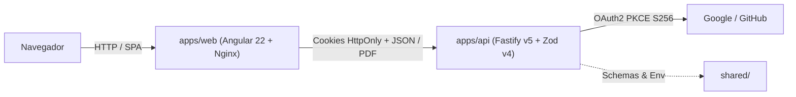
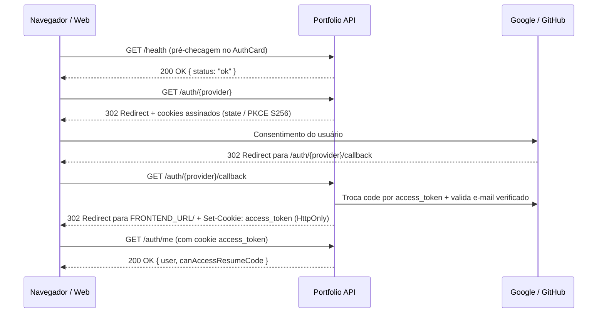

# Portfolio — Miguel L. Sommerfeld

Aplicação fullstack do meu portfólio pessoal, construída em um monorepo gerenciado por **npm workspaces** com arquitetura **100% stateless (sem banco de dados)**.

Este repositório não foi concebido como um template para terceiros instalarem ou executarem localmente — ele funciona como uma vitrine aberta de arquitetura, decisões de engenharia, segurança, experiência de interface e desenvolvimento assistido por Agentes de IA.

---

## Sumário

- [Visão Geral da Arquitetura](#visão-geral-da-arquitetura)
- [Stacks Tecnológicas](#stacks-tecnológicas)
- [Estrutura de Pastas](#estrutura-de-pastas)
- [Backend (`apps/api`)](#backend-appsapi)
- [Frontend (`apps/web`)](#frontend-appsweb)
- [Código Compartilhado (`shared/`)](#código-compartilhado-shared)
- [Containerização (`Docker` & `Nginx`)](#containerização-docker--nginx)
- [Desenvolvimento com Agentes de IA (Antigravity)](#desenvolvimento-com-agentes-de-ia-antigravity)
- [Boas Práticas Aplicadas](#boas-práticas-aplicadas)

---

## Visão Geral da Arquitetura

O projeto separa responsabilidades em quatro camadas claras dentro do mesmo repositório:

- **`apps/api`**: API HTTP stateless em Node.js ESM com Fastify v5, TypeScript estrito e Zod v4. Gerencia autenticação OAuth2 (Google e GitHub), sessão JWT em cookie `HttpOnly`, entrega controlada de currículo em PDF, healthcheck e especificação OpenAPI via Swagger.
- **`apps/web`**: SPA em Angular 22+ (100% standalone + Signals) com Tailwind CSS v4, Lenis, GSAP ScrollTrigger, tsParticles e suíte de testes unitários em Vitest. Combina dark mode em acabamento *liquid glass*, fundo interativo de partículas sincronizado aos gradientes das seções, animações acopladas ao scroll e modais integrados ao fluxo de autenticação e currículo.
- **`shared/`**: Contratos Zod comuns (`authProviderSchema`, `userPayloadSchema`) e validação centralizada de variáveis de ambiente (`env.ts`).
- **`.agent/` e `AGENTS.md`**: Camada de engenharia de contexto e especificações que orientou o desenvolvimento assistido por Agentes de IA (**Antigravity**).



---

## Stacks Tecnológicas

| Camada | Tecnologias e Ferramentas |
| :--- | :--- |
| **Monorepo & Contratos** | npm workspaces, TypeScript (`strict`), Zod v4 |
| **Backend (`apps/api`)** | Node.js 24+ (ESM), Fastify v5, `@fastify/type-provider-zod`, `@fastify/oauth2`, `@fastify/jwt`, `@fastify/cookie`, `@fastify/cors`, `@fastify/rate-limit`, `@fastify/swagger`, `@fastify/swagger-ui`, `tsx`, `tsc-alias` |
| **Frontend (`apps/web`)** | Angular 22 (Standalone + Signals + View Transitions), Tailwind CSS v4 (`@tailwindcss/postcss`), Lenis, GSAP (`ScrollTrigger`), tsParticles (`@tsparticles/angular`, `@tsparticles/engine`, `@tsparticles/slim`), RxJS, Vitest + jsdom |
| **Containerização** | Docker (builds multi-stage na API e no Web), Docker Compose, Nginx 1.27 Alpine |
| **Engenharia & IA** | Antigravity (`AGENTS.md`, `.agent/rules/`, `.agent/web/`), GitFlow + Conventional Commits |

---

## Estrutura de Pastas

```text
portfolio/
├── .agent/
│   ├── rules/
│   │   ├── api.md                          # Regras e padrões arquiteturais do backend
│   │   └── web.md                          # Regras e padrões Angular/Tailwind do frontend
│   └── web/
│       ├── home.md                         # Especificação da Homepage
│       └── components/
│           ├── auth.card.md                # Especificação de AuthCard, ResumeCard e fluxos modais
│           ├── navbar.md                   # Especificação da Navbar fixa em liquid glass
│           └── resume.md                   # Especificação da prévia 3D animada do currículo
├── apps/
│   ├── api/
│   │   ├── assets/
│   │   │   └── curriculo-dev-censurado.pdf # Variante pública/censurada do currículo
│   │   ├── private/                        # Variante completa (ignorada pelo Git)
│   │   ├── src/
│   │   │   ├── server.ts                   # Factory buildServer() e bootstrap condicional
│   │   │   ├── config/
│   │   │   │   └── swagger.ts              # Configuração OpenAPI 3.0.3 e Swagger UI (/docs)
│   │   │   ├── types/
│   │   │   │   └── fastify.d.ts            # FastifyTypedInstance, FastifyJWT e decorators
│   │   │   └── modules/
│   │   │       ├── auth/
│   │   │       │   ├── auth.routes.ts      # Registro dinâmico de OAuth2, /me e /logout
│   │   │       │   ├── auth.schema.ts      # Schemas Zod de callback, /me e erros
│   │   │       │   ├── auth.service.ts     # Orquestração de provedores e redirects
│   │   │       │   ├── token.service.ts    # Emissão JWT e política do cookie de sessão
│   │   │       │   ├── middlewares/
│   │   │       │   │   └── auth.middleware.ts
│   │   │       │   └── providers/
│   │   │       │       ├── oauth-provider.ts
│   │   │       │       ├── google.provider.ts
│   │   │       │       ├── github.provider.ts
│   │   │       │       └── index.ts
│   │   │       ├── health/
│   │   │       │   └── health.routes.ts    # Probe de disponibilidade GET /health
│   │   │       └── resume/
│   │   │           ├── resume.routes.ts    # Rotas GET /resume/ e GET /resume/code
│   │   │           ├── resume.schema.ts    # Schemas Zod de headers, PDF, código e erros
│   │   │           └── resume.service.ts   # Código diário HMAC-SHA256 e resolução do PDF
│   │   ├── Dockerfile                      # Build multi-stage (Node 24 Slim -> runtime enxuto)
│   │   ├── package.json
│   │   └── tsconfig.json                   # Aliases @/* e @shared/*
│   └── web/
│       ├── nginx/
│       │   ├── default.conf.template       # Gzip, headers de segurança, cache e fallback SPA
│       │   └── 40-generate-env-js.sh       # Injeção de API_BASE_URL em runtime (/env.js)
│       ├── public/
│       │   ├── env.js                      # Placeholder de runtime env em desenvolvimento
│       │   ├── fonts/                      # Fonte local JetBrainsMono-Medium.woff2
│       │   ├── icons/                      # Ícones de provedores e redes sociais
│       │   └── projects/                   # Capturas de tela dos projetos exibidos na vitrine
│       ├── scripts/
│       │   └── run-ng.mts                  # Carrega .env da raiz e define __API_BASE_URL__
│       ├── src/
│       │   ├── index.html
│       │   ├── main.ts
│       │   ├── styles.css                  # Tailwind v4, @font-face, keyframes e View Transitions
│       │   └── app/
│       │       ├── app.ts / app.html       # Shell raiz (Navbar, Outlet, Modais e ErrorToast)
│       │       ├── app.config.ts           # Router + View Transitions, HttpClient e AppInitializer
│       │       ├── app.routes.ts           # Lazy-loading da Home e tratamento de /login?error=
│       │       ├── core/
│       │       │   ├── config/
│       │       │   │   └── api.config.ts   # Resolução de API_BASE_URL (runtime > build > default)
│       │       │   └── services/
│       │       │       ├── api-health.service.ts
│       │       │       ├── auth.service.ts
│       │       │       ├── error-feedback.service.ts
│       │       │       ├── resume.service.ts
│       │       │       └── smooth-scroll.service.ts
│       │       ├── components/
│       │       │   ├── auth-card/          # Modal OAuth2 (Google / GitHub) com healthcheck prévio
│       │       │   ├── error-toast/        # Toast global de erros de API
│       │       │   ├── navbar/             # Barra fixa liquid glass (LinkedIn, GitHub, Code, Auth/Logout)
│       │       │   ├── particles-background/ # Fundo fixo de partículas tsParticles reativo ao gradiente ativo
│       │       │   ├── project-showcase/   # Vitrine reutilizável com scroll pinning e fallback visual
│       │       │   ├── resume/             # Folha A4 com revelação 3D sincronizada ao scroll
│       │       │   ├── resume-card/        # Modal de escolha (censurado vs. completo com código)
│       │       │   └── resume-code-card/   # Modal exclusivo de owners para exibir/copiar o código diário
│       │       └── pages/
│       │           └── home/
│       │               ├── home.ts / home.html
│       │               ├── home.projects.ts # Catálogo tipado dos projetos da vitrine
│       │               └── home.spec.ts
│       ├── Dockerfile                      # Build multi-stage (Node 24 Slim -> Nginx 1.27 Alpine)
│       ├── angular.json
│       ├── package.json
│       └── tsconfig.json                   # Aliases @config/*, @services/*, @components/*, @pages/*
├── shared/
│   ├── config/
│   │   └── env.ts                          # Parse e validação centralizada de variáveis com Zod
│   └── schemas/
│       └── jwt.schema.ts                   # authProviderSchema e userPayloadSchema
├── AGENTS.md                               # Diretrizes globais para Agentes de IA
├── .env.example                            # Modelo de variáveis de ambiente
├── docker-compose.yml                      # Orquestração local dos containers web e api
└── package.json                            # Configuração de workspaces npm
```

---

## Backend (`apps/api`)

### Arquitetura e Princípios

- **100% Stateless**: Não há banco de dados nem armazenamento de sessão em servidor. Sessões vivem exclusivamente no cookie `HttpOnly` `access_token` (JWT assinado) e o código diário do currículo é derivado deterministicamente via `HMAC-SHA256`.
- **Contratos Tipados de Ponta a Ponta**: Validação de entrada, serialização de saída, tipos TypeScript (`z.infer`) e especificação OpenAPI 3.0.3 derivam dos mesmos schemas Zod via `@fastify/type-provider-zod`.
- **Ordem Explícita de Plugins em `buildServer()`**:
  1. `@fastify/cors` (origem normalizada de `FRONTEND_URL`, `credentials: true` e `exposedHeaders: ["Content-Disposition", "X-Resume-Variant"]`)
  2. `@fastify/cookie` (cookies assinados de estado/PKCE)
  3. `@fastify/rate-limit` (limite global + sobrescritas por rota)
  4. `@fastify/jwt` (leitura exclusiva de cookie)
  5. `@fastify/swagger` e `@fastify/swagger-ui` (`/docs` e `/docs/json`)
  6. Decoração dos serviços desacoplados (`authService`, `tokenService`, `resumeService`)
  7. Registro de rotas (`/health`, `/auth`, `/resume`)
- **Provedores OAuth2 Extensíveis**: Cada provedor implementa `OAuthProvider<P>` em `modules/auth/providers/`, encapsulando escopos, validação Zod da API externa e normalização para `UserPayload`. As rotas `/auth/:provider` e `/auth/:provider/callback` são registradas dinamicamente a partir de `oauthProviders`.

### Fluxo de Autenticação Stateless (OAuth2 + JWT)



- **Google**: escopos `openid`, `email`, `profile` com PKCE `S256`, timeout de 10s e exigência de `email_verified: true`.
- **GitHub**: escopos `read:user`, `user:email` com PKCE `S256`, consultas paralelas a `/user` e `/user/emails` (timeout de 10s) e seleção do e-mail primário verificado.
- **Erros no Callback**: detalhes ficam apenas nos logs do servidor (`request.log.error`), redirecionando o navegador para `${FRONTEND_URL}/login?error=<codigo>` (`access_denied`, `invalid_callback`, `email_not_verified`, `auth_failed`).

### Entrega Controlada de Currículo (`resume`)

- **Variante Censurada (`censored`)**: retornada por padrão em `GET /resume/` a partir de `apps/api/assets/curriculo-dev-censurado.pdf`.
- **Variante Completa (`full`)**: desbloqueada enviando um código diário válido no header `x-resume-code`, servindo `apps/api/private/curriculo-dev.pdf` (não versionado no Git).
- **Código Diário Determinístico**: calculado via `HMAC-SHA256(RESUME_ACCESS_SECRET, "resume:YYYY-MM-DD")` no fuso `RESUME_TIMEZONE` (padrão `America/Sao_Paulo`), formatado em `XXXX-XXXX` e validado em tempo constante com `crypto.timingSafeEqual`. Apenas usuários cujo e-mail pertence a `OWNER_EMAILS` recebem `canAccessResumeCode: true` em `/auth/me` e podem consultar `GET /resume/code`.

### Endpoints Principais

| Método | Rota | Autenticação | Rate Limit | Função |
| :--- | :--- | :--- | :--- | :--- |
| `GET` | `/health` | Pública | Sem limite | Probe de saúde (`{ status: "ok" }`, `Cache-Control: no-store`) |
| `GET` | `/docs` / `/docs/json` | Pública | Global (`100/min`) | Swagger UI e especificação OpenAPI 3.0.3 |
| `GET` | `/auth/:provider` | Pública | Global (`100/min`) | Inicia fluxo OAuth2 PKCE (`google` ou `github`) |
| `GET` | `/auth/:provider/callback` | Cookie assinado | `20/min` | Troca o código, emite cookie `access_token` e redireciona |
| `GET` | `/auth/me` | Cookie `access_token` | Global (`100/min`) | Retorna `{ user, canAccessResumeCode }` |
| `POST` | `/auth/logout` | Pública | Global (`100/min`) | Remove o cookie `access_token` (`204 No Content`) |
| `GET` | `/resume/` | Cookie `access_token` | `10/min` | Stream inline do PDF (`censored` ou `full` via `x-resume-code`) |
| `GET` | `/resume/code` | Cookie + Owner | `20/min` | Retorna `{ code, validForDate, expiresAt }` (`no-store`) |

### Variáveis de Ambiente (Validadas em `shared/config/env.ts`)

| Grupo | Variáveis |
| :--- | :--- |
| **Servidor & Origem** | `NODE_ENV` (`development` \| `production`), `PORT` (`3333`), `FRONTEND_URL` (`http://localhost:4200`) |
| **OAuth2 (Google / GitHub)** | `GOOGLE_CLIENT_ID`, `GOOGLE_CLIENT_SECRET`, `GOOGLE_CALLBACK_URL`, `GITHUB_CLIENT_ID`, `GITHUB_CLIENT_SECRET`, `GITHUB_CALLBACK_URL` |
| **Sessão & Cookies** | `JWT_SECRET` (≥ 32 chars), `COOKIE_SECRET` (≥ 32 chars), `JWT_EXPIRES_IN` (`1h`) |
| **Currículo** | `RESUME_ACCESS_SECRET` (≥ 32 chars), `OWNER_EMAILS` (lista separada por vírgula), `RESUME_TIMEZONE` (`America/Sao_Paulo`) |

---

## Frontend (`apps/web`)

### Arquitetura Angular 22

- **100% Standalone e Reativo com Signals**: sem `NgModule`, utilizando `signal()`, `computed()`, `effect()`, `input()`, `output()`, `viewChild()`, `inject()` e a sintaxe moderna de templates (`@if`, `@for`, `@empty`), mantendo RxJS restrito a fluxos HTTP/roteamento.
- **Bootstrap e Rotas**: `app.config.ts` registra `provideRouter(routes, withViewTransitions())`, `provideHttpClient()` e `provideAppInitializer()` disparando `AuthService.checkSession()`. A Homepage é carregada sob demanda via `loadComponent`, e `/login?error=...` redireciona para `/` acionando `ErrorFeedbackService`.
- **Identidade Visual & Tipografia**: dark mode fixo (`bg-neutral-950`) em acabamento *liquid glass* (`backdrop-blur`, bordas translúcidas e reflexo especular) usando exclusivamente a fonte local **`JetBrains Mono`** (`apps/web/public/fonts/JetBrainsMono-Medium.woff2`), sem dependência de CDNs externas.

### Experiência da Homepage em 3 Atos e Fundo de Partículas

- **Partículas & Gradiente Reativo (`ParticlesBackground`)**: camada fixa (`z-0`, `aria-hidden="true"`) construída com **tsParticles** (`@tsparticles/angular` + `@tsparticles/slim`, `fpsLimit: 60`, `pauseOnBlur: true` e efeito `repulse` no hover). A Homepage monitora a seção visível via `IntersectionObserver` e recebe o `accentGradient` do slide ativo de cada `ProjectShowcase` (`activeAccentChange`); a cor RGB extraída do gradiente é interpolada suavemente com **GSAP** e aplicada em HSL (misturando tom primário e destaque claro) às partículas em tempo real, combinando-se ao glow/gradiente ambiente de cada seção. Sob `prefers-reduced-motion: reduce`, movimento e interatividade das partículas são desativados, e a inicialização verifica `OffscreenCanvas` para manter compatibilidade segura em `jsdom`.

1. **Hero com Typewriter Effect (`Home`)**: digitação progressiva da mensagem de boas-vindas com cursor pulsante, indicador de scroll via `animate.enter` e transição de saída controlada por `ScrollTrigger`.
2. **Vitrine Reutilizável de Projetos (`ProjectShowcase`)**: cada projeto em `home.projects.ts` ocupa uma seção translúcida com fundo ambiente e gradiente sincronizados à paleta do slide ativo (emitindo o gradiente atual para tingir as partículas). Em desktop (`≥ 1024px`), o `ScrollTrigger` trava a seção (`pin: true`) e alterna slides livremente pelo progresso do scroll sem `snap` forçado; em mobile ou sob `prefers-reduced-motion`, o pin é desativado e os slides permanecem navegáveis pela lista numerada. Quando um projeto não define `imageUrl`, um quadro visual estilizado com `accentGradient` evita quebra de layout.
3. **Prévia 3D do Currículo (`Resume`)**: folha vertical em proporção A4 sobre palco `sticky` com perspectiva 3D (`rotateX`, `scale` e paralaxe do símbolo `?`) sincronizada ao scroll (`scrub: 0.6`), revelando o CTA **`Acessar currículo`**.

### Modais Globais e Integração com a API

Montados diretamente no shell raiz (`app.html`) para disponibilidade imediata sem alterar o `overflow` do `body` (preservando o `position: sticky` da página):

- **`Navbar`**: barra fixa (`h-14`) com efeito hover inspirado na dock do macOS, links para LinkedIn e GitHub, botão **`Code`** condicional para owners (`canAccessResumeCode()`) e alternância reativa entre **`Auth`** e **`Logout`**.
- **`AuthCard`**: antes de redirecionar para `/auth/google` ou `/auth/github`, consulta `GET /health` via `ApiHealthService` para evitar que o usuário caia em erro bruto caso a API esteja indisponível.
- **`ResumeCard`**: acionado após validação de sessão em `GET /auth/me`. Se retornar `401`, grava a intenção não sensível em `sessionStorage` e abre o `AuthCard`; no retorno do OAuth2, o `ResumeCard` abre automaticamente para escolha entre currículo **sem dados sensíveis** ou **com dados sensíveis** (input formatado `XXXX-XXXX` enviado em `x-resume-code`).
- **`ResumeCodeCard`**: exclusivo para owners autenticados; consulta `GET /resume/code`, formata validade/expiração em `pt-BR` e permite copiar o código com feedback visual.
- **`ErrorToast`**: feedback global acessível (`role="alert"`, `aria-live="assertive"`) com descarte automático e manual.

### Configuração de Ambiente e Qualidade

- **Resolução Dinâmica da URL da API (`api.config.ts`)**: prioridade `window.__ENV__.API_BASE_URL` (injetado pelo Nginx em runtime via `/env.js`) → `__API_BASE_URL__` (definido em build/dev via `scripts/run-ng.mts` lendo o `.env` da raiz) → fallback `http://localhost:3333`.
- **Rolagem Suave e Acessibilidade**: `SmoothScrollService` integra `Lenis` ao ticker do `GSAP`, cancela inércia ao abrir modais (`cancelMomentum()`), desativa animações sob `prefers-reduced-motion: reduce` e protege chamadas em `jsdom` quando `matchMedia` não existe.
- **Testes Unitários (Vitest)**: **16 arquivos `.spec.ts`** cobrindo todos os componentes (`App`, `Navbar`, `Home`, `ParticlesBackground`, `ProjectShowcase`, `Resume`, `AuthCard`, `ResumeCard`, `ResumeCodeCard`, `ErrorToast`) e todos os serviços/configs (`api.config`, `ApiHealthService`, `AuthService`, `ErrorFeedbackService`, `ResumeService`, `SmoothScrollService`).

---

## Código Compartilhado (`shared/`)

A pasta `shared/` reúne apenas contratos puros em TypeScript + Zod, sem acoplamento a Fastify ou Angular:

- `shared/schemas/jwt.schema.ts`: define `authProviderSchema` e `userPayloadSchema` e exporta os tipos inferidos `AuthProvider` e `UserPayload`.
- `shared/config/env.ts`: valida e converte todas as variáveis de ambiente na inicialização (incluindo verificação de fuso IANA via `Intl.DateTimeFormat` e normalização de `OWNER_EMAILS`).

> **Decisão intencional de isolamento:** `apps/web/Dockerfile` usa contexto `./apps/web` para manter a imagem do frontend enxuta e independente da raiz. Por isso, o frontend não importa arquivos de `shared/` diretamente e mantém interfaces TypeScript enxutas compatíveis com os payloads da API.

---

## Containerização (`Docker` & `Nginx`)

A aplicação é empacotada para execução containerizada via `docker-compose.yml`, com os serviços `web` (porta `4200`) e `api` (porta `3333`) em **builds multi-stage** conectados em uma rede bridge dedicada (`public_net`):

- **Frontend (`apps/web/Dockerfile` — Multi-Stage)**:
  1. Estágio `build` (`node:24-slim`): instala dependências e gera o bundle estático de produção do Angular.
  2. Estágio `runtime` (`nginx:1.27-alpine`): copia apenas os artefatos compilados (`/usr/share/nginx/html`) e configura o Nginx via `default.conf.template` e `40-generate-env-js.sh`.
  - **Configuração em Runtime**: ao iniciar o container, `40-generate-env-js.sh` gera `/env.js` a partir de `API_BASE_URL`, permitindo promover a mesma imagem entre ambientes sem rebuild.
  - **Nginx de Produção**: compressão Gzip (incluindo `woff2` e `svg`), `server_tokens off`, headers de segurança (`X-Content-Type-Options: nosniff`, `X-Frame-Options: DENY`, `Referrer-Policy: strict-origin-when-cross-origin`), `Cache-Control: no-store` em `/index.html` e `/env.js`, cache imutável de 1 ano para bundles `js`/`css`/`woff2` e fallback SPA (`try_files $uri $uri/ /index.html`).
- **Backend (`apps/api/Dockerfile` — Multi-Stage)**:
  1. Estágio `build` (`node:24-slim`, contexto na raiz do monorepo): instala o workspace `@portfolio/api`, compila TypeScript + path aliases (`tsc && tsc-alias --resolve-full-paths`) e remove `devDependencies` via `npm prune --omit=dev`.
  2. Estágio `runtime` (`node:24-slim`): copia apenas as dependências de produção, o bundle compilado `dist/` e os diretórios `assets/` e `private/`, iniciando com `npm start`.

---

## Desenvolvimento com Agentes de IA (Antigravity)

O projeto foi desenvolvido de forma iterativa combinando arquitetura definida manualmente com execução assistida por **Agentes de IA no Antigravity**. Em vez de prompts soltos, a engenharia do repositório estruturou uma base versionada de contexto e especificações:

1. **Diretrizes Hierárquicas de Contexto**:
   - [`AGENTS.md`](./AGENTS.md) define regras globais não negociáveis: foco estrito na tarefa (*no scope creep*), KISS & YAGNI, proibição de `any`, estilo de código consistente (chaves Allman em classes/métodos, imports compactos) e validação obrigatória de build/testes.
   - [`.agent/rules/api.md`](./.agent/rules/api.md) e [`.agent/rules/web.md`](./.agent/rules/web.md) isolam convenções de cada stack (plugins Fastify, desacoplamento de serviços, Angular standalone com Signals, fonte local, restrições do contexto Docker).
2. **Desenvolvimento Guiado por Especificações (Spec-Driven)**:
   - Antes de implementar telas e fluxos críticos no frontend, foram redigidos documentos em `.agent/web/` (`home.md`, `navbar.md`, `resume.md`, `auth.card.md`) descrevendo anatomia visual, tokens Tailwind, animações, acessibilidade e critérios de aceite.
3. **Iteração e Revisão Humana**:
   - O fluxo seguiu um **GitFlow simplificado** (`main`, `develop`, branches `feature/*`, `refactor/*`, `chore/*`, `docs/*`) com Pull Requests e **Conventional Commits**. Cada entrega assistida pelo Antigravity passou por revisão de código, validação de `npm run build` e `npm test` (Vitest no frontend) e ajustes iterativos de UX e segurança até o resultado final.

---

## Boas Práticas Aplicadas

- **Segurança por Padrão**: cookies `HttpOnly` + `SameSite=Lax` + `Secure` em produção; PKCE `S256` e cookies assinados isolados por provedor; validação exclusiva via cookie (`onlyCookie: true`); logout apenas por `POST`; `crypto.timingSafeEqual` na verificação do código diário; `Cache-Control: no-store` em endpoints sensíveis; rate limiting granular; CORS restrito à origem normalizada; headers de hardening no Nginx e segredos com tamanho mínimo validados no boot.
- **Tipagem Estrita e Zero Boilerplate**: `strict: true` sem uso de `any`, inferência de tipos a partir de schemas Zod (`z.infer`) na API e estado reativo leve com Angular Signals sem bibliotecas de estado pesadas.
- **Separação de Responsabilidades**: serviços da API desacoplados de `FastifyRequest`/`FastifyReply`, adaptadores OAuth2 plugáveis sob contrato único, componentes standalone co-localizados no frontend e aliases de importação limpos em ambos os workspaces.
- **Acessibilidade e Resiliência de UX**: respeito integral a `prefers-reduced-motion: reduce`, diálogos acessíveis (`role="dialog"`, `aria-modal`, `Escape`, restauração de foco sem salto de scroll), healthcheck antes de redirecionamentos OAuth2, fallback visual para imagens ausentes e feedback amigável de erros.
- **Qualidade Automatizada no Frontend**: suíte Vitest cobrindo componentes, serviços, resolução de ambiente e cenários de borda em `jsdom`, garantindo evolução segura da interface.
